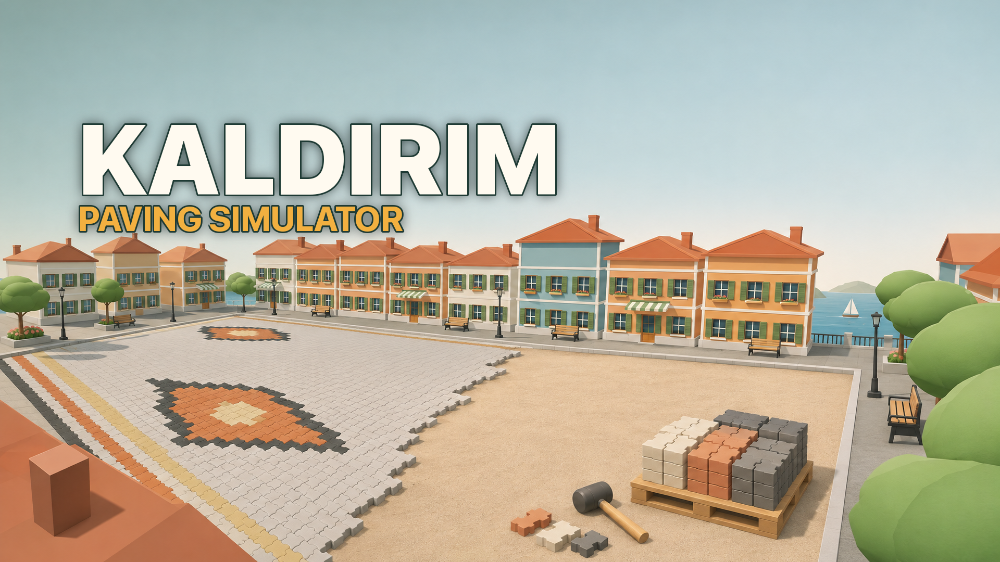
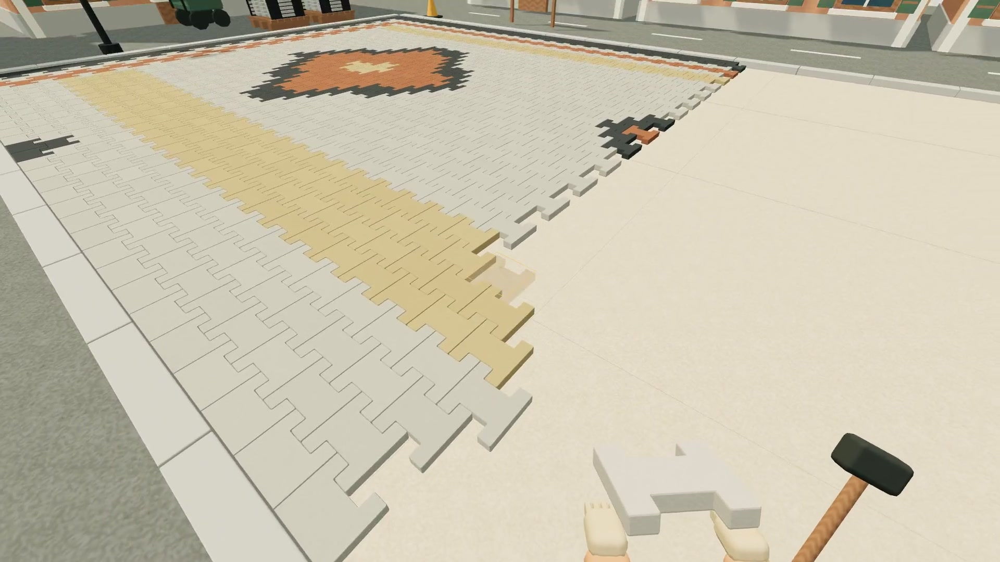
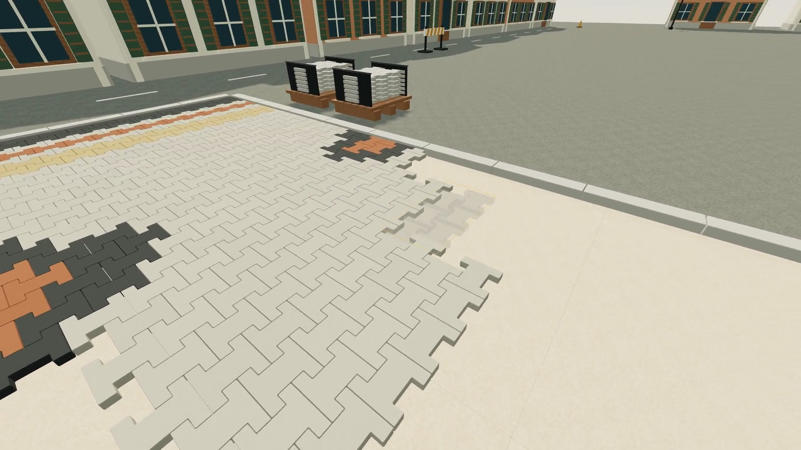
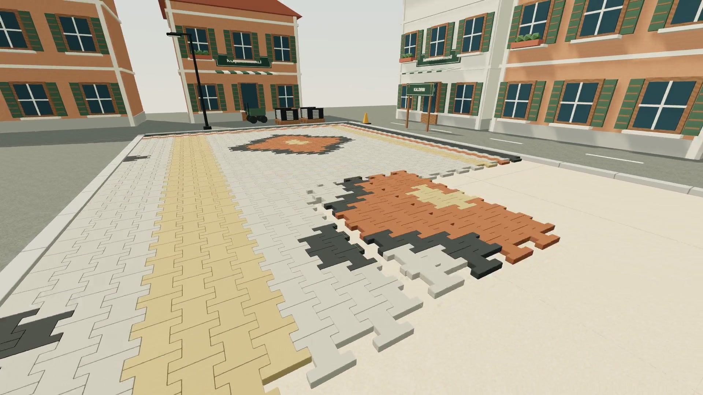

# Kaldırım: Paving Simulator



**One stone. Then a row. Then the whole street.**

A first-person paving simulator that runs entirely in the browser. You are a paving contractor in a small coastal town: five large jobs, leased equipment, and tens of thousands of stones — every single one placed by you, by hand or by machine.

**[▶ Play now — free, no install, no account](https://kaldirim.space.fast/)**

## Screenshots

| | | |
|---|---|---|
|  |  |  |

All imagery is captured from the game itself; there are no external assets to photograph.

## The game

- **Big jobs from the first minute.** No training levels, no tiny demos: five complete jobs, from an 11,712-stone seaside sidewalk to a 42,380-stone old-town courtyard.
- **Wages per stone, not per minute.** Every unique stone you lay pays during the job. Leased equipment and upgrades reset only when you start a different or replayed job — closing the browser never wipes your work.
- **Honest mechanics.** Paving requires a stable, reachable footprint and a timed working motion. Sweeping the cursor over the ground paints nothing and pays nothing.
- **Everything procedural.** All geometry, materials, environment and tools are generated with Three.js. All sound is synthesized with Web Audio. No external models, textures or music; no runtime AI requests.
- **Respectful of the player.** Turkish and English UI, pause anywhere, keyboard access, reduced-motion setting, offline service worker, exportable validated save files. No accounts, no ads of its own, nothing that identifies a player — the standalone build sends nothing at all.

## Jobs

| Job | | Stones |
|---|---|---:|
| Seaside Street | L-shaped sidewalk | 11,712 |
| Market Square | open plaza | 18,080 |
| Plane Tree Park | connected garden paths | 26,776 |
| Coastal Walk | promenade with viewing bays | 32,256 |
| Old Neighborhood | courtyard with garden corners | 42,380 |

## Equipment

Wages are earned inside the job and spent inside the job. Better tools cover more ground per motion:

| Tool | Stones per motion |
|---|---:|
| By Hand | 1 |
| Mechanical Clamp | 6 |
| Row Layer | 18 |
| K-48 Paving Machine | 48 |

Upgrades: carrying capacity, working speed, mobile supplies, working reach and a wider paving head. Materials are always free — you are paid for labor, not shopping.

## Controls

| Input | Action |
|---|---|
| WASD / Shift | Walk / walk faster |
| Mouse | Look |
| Hold left button | Work on a steady target |
| R or E | Resupply |
| B | Equipment and upgrades |
| 1–4 | Switch leased tools |
| Q | Rotate the working footprint |
| F | Point at the nearest gap |
| Tab | Map |
| P or Esc | Pause / release the mouse |
| F3 | Draw/FPS diagnostics |

## Technology

TypeScript (strict) + Three.js + Rapier (WASM physics) + Vite. The game simulation — grid, economy, saves — is independent of the DOM and the renderer; rendering consumes simulation results but cannot mint money. Stable integer grid IDs are the save schema.

The production build is a static `dist/` that any HTTPS static host can serve: seven assets, about 1 MiB gzipped, with an offline service worker. A separate portal build mode exists for embedding platforms; the standalone build contains no ads and no purchase flows.

## Running locally

Node.js 22.12+ is recommended.

```bash
npm ci
npm run dev
```

```bash
npm run check          # strict TypeScript + unit tests + production build
npm run test:e2e       # real-browser smoke tests (needs: npx playwright install --with-deps chromium)
npm run preview        # serve the production build
```

## Documentation

- `GAME_DESIGN.md` — the accepted rules of the game
- `ART_DIRECTION.md` — visual targets
- `docs/ARCHITECTURE.md` — module boundaries and technical decisions
- `docs/ECONOMY.md` — in-job progression and balance
- `docs/EVOLUTION.md` — notification, equipment-feel and finishing systems
- `docs/RELEASE.md` — pre-release checklist
- `docs/STATUS.md` — what is implemented, what is verified, what is still open
- `THIRD_PARTY_NOTICES.md` — dependencies and reference research

## Contributing

Issues and pull requests are welcome. Please read `AGENTS.md` and `docs/ARCHITECTURE.md` first — the project has firm boundaries (simulation purity, no external assets, no speculative features) that are part of its identity. Large changes are best discussed in an issue before writing code.

## An honest note on quality

Passing tests do not prove the game feels good or hits 60 FPS on your machine. Real-hardware performance, full-campaign human playtesting and wider browser coverage are still open items — see `docs/RELEASE.md` and `docs/STATUS.md` for exactly what has and has not been verified.

## License

MIT — see `LICENSE`. Third-party dependencies keep their own licenses; see `THIRD_PARTY_NOTICES.md`.

---

## Türkçe

**Kaldırım: Paving Simulator** — tamamen tarayıcıda çalışan, birinci şahıs taş döşeme oyunu. Önce bir taş, sonra bir sıra, sonunda bütün sokak.

**[▶ Hemen oyna — kurulum yok, hesap yok](https://kaldirim.space.fast/)**

Küçük bir sahil kasabasında taş döşeme ustasısın: beş büyük iş, kiralanan ekipman ve on binlerce taş — her biri senin elinden geçiyor.

- **İlk dakikadan büyük iş.** Eğitim bölümü yok: 11.712 taşlık sahil sokağından 42.380 taşlık eski mahalle avlusuna beş tam şantiye.
- **Taş başına işçilik.** Döşediğin her yeni taş için işin içinde işçilik kazanırsın. Kiraladığın ekipman ve yükseltmeler yalnızca başka bir işe geçince sıfırlanır; tarayıcıyı kapatmak emeğini silmez.
- **Dürüst mekanik.** Taş döşemek için sağlam, erişilebilir bir çalışma alanına nişan almak ve aletin hareketini tamamlamak gerekir. Fareyi rastgele savurmak yeri boyamaz, para yazdırmaz.
- **Her şey prosedürel.** Bütün modeller, yüzeyler ve dünya Three.js ile üretiliyor; sesler Web Audio ile sentezleniyor. Dışarıdan model, doku, müzik yok; yapay zekâ çağrısı yok. Hesap yok, oyunun kendi reklamı yok, oyuncuyu tanımlayan hiçbir veri yok.
- **Oyuncuya saygı.** Türkçe ve İngilizce arayüz, istediğin yerde duraklatma, klavye erişimi, azaltılmış hareket ayarı, çevrimdışı çalışma ve dışa aktarılabilen kayıt dosyaları.

Kendi bilgisayarında çalıştırmak için Node.js 22.12+ ile `npm ci && npm run dev` yeterli. Katkı vermek istersen önce `AGENTS.md` ve `docs/ARCHITECTURE.md` dosyalarına göz at; sorun ve önerilerini GitHub Issues'da bildirebilirsin.

Lisans: MIT — ayrıntılar `LICENSE` dosyasında.
